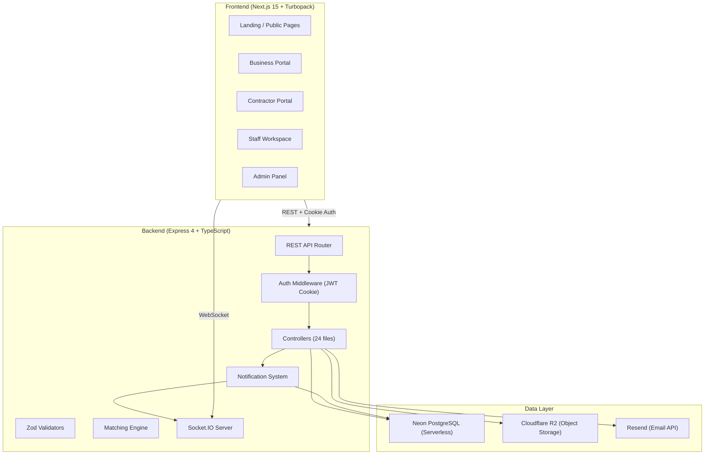
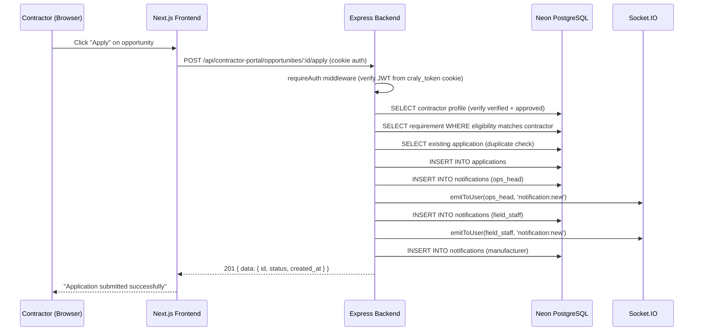
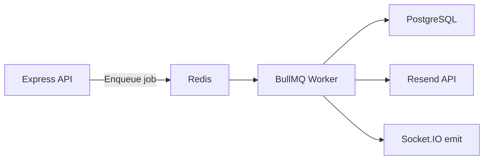
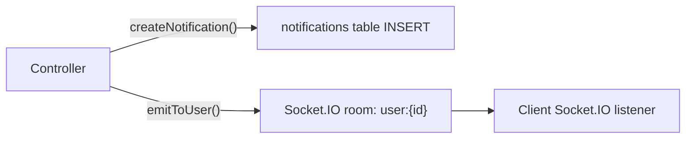
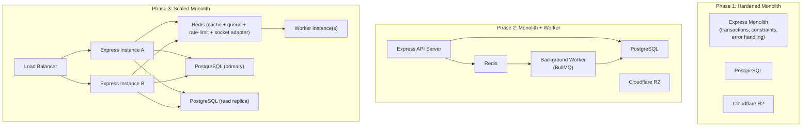
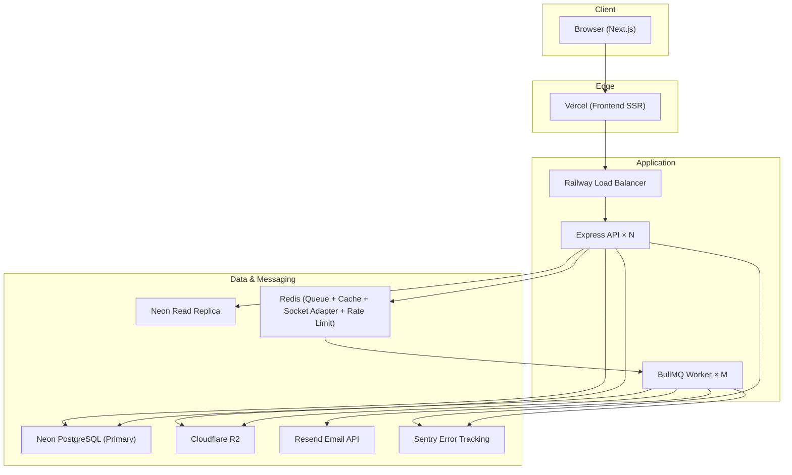

# Craly — Comprehensive System Design & Scalability Analysis

> **Audit date**: October 2026 · **Codebase snapshot**: `main` @ `eebf379`
> **Scope**: Full-stack analysis — Express/postgres.js backend, Next.js 15 frontend, Neon PostgreSQL, Cloudflare R2, Resend email, Socket.IO real-time.

---

## Table of Contents

1. [Existing Architecture](#1-existing-architecture)
2. [Concurrency & Race Conditions](#2-concurrency--race-conditions)
3. [Idempotency & Duplicate Requests](#3-idempotency--duplicate-requests)
4. [Rate Limiting & Abuse Prevention](#4-rate-limiting--abuse-prevention)
5. [Database Consistency & Transactions](#5-database-consistency--transactions)
6. [Matching Algorithm Scalability](#6-matching-algorithm-scalability)
7. [Caching Strategy](#7-caching-strategy)
8. [Queues & Background Jobs](#8-queues--background-jobs)
9. [Authentication, Authorization & Session Security](#9-authentication-authorization--session-security)
10. [File Uploads & Object Storage](#10-file-uploads--object-storage)
11. [Notifications & Real-Time Communication](#11-notifications--real-time-communication)
12. [Scalability & Performance Bottlenecks](#12-scalability--performance-bottlenecks)
13. [Failure Handling & Resilience](#13-failure-handling--resilience)
14. [Monitoring, Logging & Observability](#14-monitoring-logging--observability)
15. [Architecture Evolution](#15-architecture-evolution)
16. [Prioritized Implementation Roadmap](#16-prioritized-implementation-roadmap)
17. [Final System Design Assessment](#17-final-system-design-assessment)

---

## 1. Existing Architecture

### 1.1 High-Level Architecture

Craly is a **brokered manpower marketplace** connecting manufacturers (businesses) who need contract workers with contractors who can supply them, intermediated by Craly's own internal staff.



### 1.2 Technology Stack

| Layer | Technology | Notes |
|-------|-----------|-------|
| Frontend | Next.js 15 (React 19), Turbopack, TypeScript, Socket.IO client | Deployed on Vercel |
| Backend | Express 4, TypeScript, ts-node-dev | Deployed on Railway |
| Database | PostgreSQL via Neon (serverless), postgres.js driver | Pool: max 10, SSL required |
| Object Storage | Cloudflare R2 (S3-compatible) | Private bucket, signed URLs |
| Email | Resend API | Transactional emails only |
| Real-time | Socket.IO 4 | JWT-authenticated connections |
| Migrations | node-pg-migrate | 25 migrations total |
| Validation | Zod 4 | Server-side request validation |
| Auth | JWT (jsonwebtoken), bcrypt, httpOnly cookies | 7-day expiry |

### 1.3 Database Schema (Final State)

**Core tables** (after all 25 migrations):

| Table | Purpose | Key Relationships |
|-------|---------|-------------------|
| `users` | Authentication: email, password_hash, role, is_active | PK for all auth |
| `contractor_profiles` | Contractor companies | FK → users (nullable), has many documents/certificates |
| `business_profiles` | Manufacturer companies | FK → users |
| `organization_members` | Multi-user-per-company (future) | FK → users + one-of(business/contractor) |
| `manpower_requirements` | Job postings by manufacturers | FK → business_profiles |
| `applications` | Contractor applications to requirements | FK → requirements + contractor_profiles; UNIQUE(requirement_id, contractor_id) |
| `contractor_documents` | KYC/verification files (metadata; files in R2) | FK → contractor_profiles |
| `contractor_certificates` | Licenses/certifications | FK → contractor_profiles |
| `contractor_worksite_photos` | Portfolio photos (metadata; files in R2) | FK → contractor_profiles |
| `verification_reviews` | Staff review history per contractor | FK → contractor_profiles |
| `contractor_certification_assessments` | In-person/remote assessment records | FK → contractor_profiles |
| `inquiries` | Direct business→contractor enquiries | FK → business + contractor profiles |
| `messages` | Chat messages within enquiries | FK → inquiries |
| `notifications` | In-app notification records | FK → users |
| `audit_logs` | Staff action audit trail | FK → users |
| `auth_verifications` | OTP records (signup + password reset) | Indexed on target+type+verified |
| `service_categories` | Lookup table for contractor service types | Referenced by contractor_categories |
| `contractor_requests` | "List Your Company" lead intake | Independent of auth |

### 1.4 Data Flow: Contractor Applies to Requirement



### 1.5 Architectural Style Assessment

Craly is a **traditional monolithic server** — a single Express process handling all routes, business logic, background notifications, file uploads, and WebSocket connections. This is **appropriate for Craly's current stage**:

- The team is small (1–2 developers)
- User volume is low (likely < 100 concurrent users)
- The domain is still evolving rapidly (25 migrations in ~4 months)
- Deployment is simple (single Railway service)

The monolith avoids the operational overhead of distributed systems while keeping the codebase navigable. The code is reasonably well-structured: routes → controllers → DB, with shared utilities for matching, notifications, and file validation.

> [!IMPORTANT]
> The monolith is correct for now, but some operations (matching notifications, email dispatch) are synchronous and inline, meaning a slow email API or a large notification fan-out directly increases API response times.

---

## 2. Concurrency & Race Conditions

### 2.1 Critical: Multiple Contractors Selected for Same Requirement

**Scenario**: Two users logged into the same manufacturer account click "Select" on two different contractors for the same requirement simultaneously.

**Current implementation** ([businessPortalController.ts:615–737](file:///d:/work/craly_main/craly/backend/src/controllers/businessPortalController.ts#L615-L737)):
1. Verify application belongs to caller's requirement (read)
2. `UPDATE applications SET status = 'SELECTED'` (single row)
3. `UPDATE manpower_requirements SET status = 'SELECTED'`
4. `UPDATE applications SET status = 'REJECTED' WHERE requirement_id = ... AND id != ... AND status != 'REJECTED'`

**Race condition**: ✅ **YES — CONFIRMED**. Steps 1–4 are **not wrapped in a transaction**. Two concurrent PATCH requests can both pass step 1 (both see the requirement in a non-SELECTED state), both execute step 2 (both applications become SELECTED), and step 4 would then reject each other's application — resulting in **zero SELECTED contractors** or **two SELECTED contractors**, depending on execution interleaving.

**Business impact**: The business rule "only one contractor can be SELECTED per requirement" is enforced **only by application-level auto-rejection logic**, not by any database constraint. There is no `UNIQUE` partial index on `applications(requirement_id) WHERE status = 'SELECTED'`, no `FOR UPDATE` lock, and no transaction boundary.

**Recommended fix**:
```sql
-- Option A: Database-level enforcement (strongest)
CREATE UNIQUE INDEX idx_one_selected_per_requirement
  ON applications (requirement_id)
  WHERE status = 'SELECTED';

-- Option B (complementary): Wrap the entire select+reject flow in sql.begin()
-- with SELECT ... FOR UPDATE on the requirement row
```

### 2.2 Duplicate Contractor Applications

**Scenario**: A contractor double-clicks "Apply" or retries after a timeout.

**Current implementation** ([contractorPortalController.ts:536–544](file:///d:/work/craly_main/craly/backend/src/controllers/contractorPortalController.ts#L536-L544)):
```typescript
const [existing] = await sql`
  SELECT id FROM applications WHERE requirement_id = ${requirementId} AND contractor_id = ${cp.id}
`;
if (existing) { ... 409 }
```

**Race condition**: ✅ **YES**. The check-then-insert is not atomic. Two concurrent requests can both pass the SELECT (both see no existing application), then both INSERT, and the second will either succeed (creating a duplicate) or fail at the database constraint.

**Mitigated at DB level**: ✅ **PARTIALLY**. The `applications_req_contractor_unique` constraint (`UNIQUE(requirement_id, contractor_id)`) from [migration 1788200000000](file:///d:/work/craly_main/craly/backend/migrations/1788200000000_manpower_requirements_and_applications.cjs#L77-L79) will cause the second INSERT to throw a unique violation error. However, this error is **not caught and translated** into a friendly 409 — it propagates as an unhandled Postgres error and becomes a generic 500 "Something went wrong."

**Fix**: Catch the unique violation (code `23505`) in `applyToOpportunity` and return 409, or use `INSERT ... ON CONFLICT DO NOTHING RETURNING id` and check if the row was actually inserted.

### 2.3 Duplicate User Registration

**Scenario**: Two concurrent signup requests with the same email.

**Current implementation** ([authController.ts:164–170](file:///d:/work/craly_main/craly/backend/src/controllers/authController.ts#L164-L170)):
```typescript
const existing = await sql`SELECT id FROM users WHERE email = ${email}`;
if (existing.length > 0) { ... 409 }
// ... later:
const user = await sql.begin(async (tx) => {
  const [newUser] = await tx`INSERT INTO users ...`;
```

**Race condition**: ✅ **YES** — the existence check is outside the transaction. However, `users.email` is `UNIQUE` (`citext`), so the database will reject the duplicate INSERT. The error surfaces as a 500 instead of a 409, same issue as above.

**Mitigated at DB level**: ✅ Yes, but UX is poor (500 instead of 409).

### 2.4 Two Staff Members Reviewing the Same KYC Document

**Scenario**: Two staff members click "Approve" on the same contractor document simultaneously.

**Current implementation** ([staffController.ts:731–836](file:///d:/work/craly_main/craly/backend/src/controllers/staffController.ts#L731-L836)):
1. SELECT document
2. UPDATE document status
3. INSERT verification_review record
4. SELECT all documents → compute overall contractor status
5. UPDATE contractor_profiles verification_status
6. SELECT contractor.user_id
7. INSERT notification

**Race condition**: ✅ **YES**. No transaction wraps this flow. Two concurrent reviews could:
- Both read the document as 'pending'
- Both update it (last write wins — one review is silently lost)
- Both compute the overall status independently (one might see stale data from step 4)
- Two duplicate notifications are sent

**Impact**: The document ends up with one decision, but the notification and verification_reviews table may contain contradictory records. The overall contractor verification_status could be wrong if the two staff members made different decisions on different documents.

**Fix**: Wrap in `sql.begin()` with `SELECT ... FOR UPDATE` on the document row.

### 2.5 Concurrent Worksite Photo Uploads Exceeding Limit

**Scenario**: A contractor opens two browser tabs and uploads 6 photos in each, with a maximum limit of 10.

**Current implementation** ([worksitePhotoController.ts:154–176](file:///d:/work/craly_main/craly/backend/src/controllers/worksitePhotoController.ts#L154-L176)):
```typescript
const [{ count }] = await sql`SELECT count(*)::int ... WHERE contractor_id = ...`;
const remainingSlots = MAX_WORKSITE_PHOTOS_COUNT - count;
if (remainingSlots <= 0) return next(badRequest(...));
if (files.length > remainingSlots) return next(badRequest(...));
// ... then INSERT individually in a loop
```

**Race condition**: ✅ **YES**. The count check and subsequent INSERTs are not transactional. Two concurrent requests each reading count=4 would both see 6 remaining slots, and each upload 6 photos, resulting in 16 photos (6 over the limit).

**Fix**: Wrap in a transaction with a `SELECT count(*) ... FOR UPDATE` (or use a CHECK constraint function, or insert-and-verify-count-then-rollback pattern).

### 2.6 Summary of Race Conditions

| Scenario | Has Race? | DB Constraint Safety Net? | Severity |
|----------|-----------|--------------------------|----------|
| Multiple contractors SELECTED per requirement | ✅ Yes | ❌ No constraint | 🔴 **Critical** |
| Duplicate application submission | ✅ Yes | ✅ Unique constraint (but 500 instead of 409) | 🟡 Medium |
| Duplicate user registration | ✅ Yes | ✅ Unique constraint (but 500 instead of 409) | 🟡 Medium |
| Concurrent document reviews | ✅ Yes | ❌ No protection | 🟠 High |
| Concurrent photo uploads exceeding limit | ✅ Yes | ❌ No protection | 🟡 Medium |
| Concurrent OTP send for same email | ✅ Yes | ❌ Could create orphan records | 🟢 Low |

---

## 3. Idempotency & Duplicate Requests

### 3.1 Non-Idempotent Operations Inventory

| Operation | Endpoint | Naturally Idempotent? | Has Idempotency Protection? | Risk |
|-----------|----------|----------------------|----------------------------|------|
| Signup | POST /auth/signup | No | DB unique email (500 error) | 🟡 |
| Send OTP | POST /auth/send-otp | No | Replaces previous OTP | ✅ Safe |
| Apply to opportunity | POST /contractor-portal/opportunities/:id/apply | No | DB unique constraint (500) | 🟡 |
| Create requirement | POST /business-portal/requirements | No | ❌ None | 🟠 |
| Select contractor | PATCH /applications/:id/status (→SELECTED) | No | ❌ None | 🔴 |
| Upload document | POST /contractor-portal/documents | No | ❌ None (duplicate files possible) | 🟡 |
| Upload worksite photos | POST /contractor-portal/worksite-photos | No | ❌ None | 🟡 |
| Create notification | Internal function | No | ❌ None | 🟡 |
| Forgot password | POST /auth/forgot-password | No | Replaces previous OTP | ✅ Safe |

### 3.2 Critical Gap: No Idempotency Keys

Craly has **zero idempotency key support** anywhere in the API. No endpoint accepts or generates an idempotency key. This means:

1. **Network retries** (browser retries after timeout, mobile apps with retry logic) will create duplicate records for POST endpoints that lack unique constraints.
2. **User double-clicks** on submit buttons could create duplicate requirements, duplicate notifications, or trigger duplicate notification fan-outs.

### 3.3 Recommended Strategy

**Phase 1 — Leverage existing database constraints** (immediate):
- Catch Postgres unique violation errors (`23505`) in all controllers and return 409 instead of 500
- Add `ON CONFLICT DO NOTHING` where appropriate

**Phase 2 — Frontend debouncing** (immediate):
- Disable submit buttons after click until response
- Already partially done in some forms

**Phase 3 — Idempotency keys** (future, when payment flows are added):
- Add `X-Idempotency-Key` header support
- Store in `idempotency_keys` table with TTL
- Return cached response for duplicate keys

### 3.4 Lost Response Scenario

**What happens when the backend commits a signup but the response is lost?**

1. User's browser shows an error or timeout
2. User clicks "Sign Up" again
3. Backend receives the same email → finds it already exists → returns 409
4. Frontend shows "An account with this email already exists"
5. User must go to login page manually

**Current behavior is acceptable** but UX is poor — the 409 message should suggest "Try logging in instead" (which it does: `"An account with this email already exists. Please log in instead."`). ✅

---

## 4. Rate Limiting & Abuse Prevention

### 4.1 Current Rate Limits

Craly uses `express-rate-limit` — **in-memory**, IP-based. Configured in:
- [authRoutes.ts](file:///d:/work/craly_main/craly/backend/src/routes/authRoutes.ts#L8-L30)
- [routes/index.ts](file:///d:/work/craly_main/craly/backend/src/routes/index.ts#L45-L52)

| Endpoint Group | Window | Limit | Notes |
|---------------|--------|-------|-------|
| OTP (send + verify) | 15 min | 10/IP | ✅ Good |
| Login | 15 min | 10/IP | ✅ Good |
| Signup | 1 hour | 10/IP | ✅ Good |
| Contact form | 15 min | 5/IP | ✅ Good |
| Contractor requests | 15 min | 5/IP | ✅ Good (shares contact limit) |
| All other endpoints | ∞ | None | 🔴 **Missing** |

### 4.2 Unprotected Endpoints

| Endpoint | Risk | Recommendation |
|----------|------|----------------|
| POST /business-portal/requirements | Requirement spam | 10/hr per user |
| POST /contractor-portal/opportunities/:id/apply | Application spam | 20/hr per user |
| POST /contractor-portal/documents | Upload abuse (R2 costs) | 20/hr per user |
| POST /contractor-portal/worksite-photos | Upload abuse | 10/hr per user |
| GET /contractors | Scraping | 60/min per IP |
| POST /enquiries | Enquiry spam | 10/hr per user |
| GET /auth/me | Called on every page load | 120/min per IP |
| POST /auth/forgot-password | Email spam | Already uses loginRateLimit ✅ |

### 4.3 In-Memory Limiter Limitation

> [!WARNING]
> The current `express-rate-limit` stores counters in-memory. If Craly scales to multiple backend instances (Railway horizontal scaling), **each instance has its own counter**, effectively multiplying the rate limit by the number of instances.

**Fix when scaling**: Replace with `rate-limit-redis` or `@express-rate-limit/redis` backed by a shared Redis instance. Not needed until horizontal scaling.

### 4.4 Missing Account-Based Limits

All current limits are IP-based. This means:
- A malicious authenticated user could bypass limits by switching IPs
- Legitimate users behind corporate NATs could be incorrectly blocked

**Recommendation**: Add per-user-id rate limits (keyed on `req.user.sub`) for authenticated mutation endpoints, complementing (not replacing) IP limits.

---

## 5. Database Consistency & Transactions

### 5.1 Transaction Usage Audit

| Operation | Uses Transaction? | Should It? | Risk |
|-----------|------------------|------------|------|
| Signup (user + profile + org_member) | ✅ `sql.begin()` | ✅ | None |
| Staff creates contractor (user + profile + org_member) | ✅ `sql.begin()` | ✅ | None |
| Select contractor (update app + update req + reject others + notify) | ❌ | ✅ | 🔴 **Critical** |
| Document review (update doc + insert review + compute overall + update profile + notify) | ❌ | ✅ | 🟠 High |
| Apply to opportunity (check dup + insert app + notify×3) | ❌ | ✅ (for insert) | 🟡 Medium |
| Upload document (R2 put + DB insert + update profile status) | ❌ | ✅ (for DB ops) | 🟡 Medium |
| Upload worksite photos (count check + R2 put + DB insert loop) | ❌ | ✅ | 🟡 Medium |
| Password reset (verify OTP + update password + delete OTP) | ❌ | ✅ | 🟡 Medium |
| Delete document (R2 delete + DB delete) | ❌ | See §10 | 🟡 Medium |

### 5.2 Missing Indexes

The schema has reasonable indexing for the current scale, but several queries would benefit from additional indexes:

| Query Pattern | Current Index? | Recommended Index |
|--------------|---------------|-------------------|
| `applications WHERE contractor_id AND status IN (...)` | ✅ contractor_id, ✅ status (separate) | Composite: `(contractor_id, status)` |
| `notifications WHERE user_id AND is_read = false` | ❌ | `(user_id, is_read) WHERE is_read = false` partial |
| `contractor_profiles WHERE verification_status AND onboarding_complete` | ✅ `(city, verification_status)` | Add `(verification_status, onboarding_complete)` |
| `auth_verifications WHERE target AND target_type ORDER BY created_at DESC` | ✅ Composite index exists | ✅ Adequate |
| `manpower_requirements WHERE status IN (...) AND eligibility conditions` | ✅ status | Composite: `(status, city, state)` |

### 5.3 Missing Unique Constraints

| Scenario | Current Protection | Recommended |
|----------|-------------------|-------------|
| One SELECTED application per requirement | ❌ App logic only | Partial unique index on `applications(requirement_id) WHERE status = 'SELECTED'` |
| One active profile per user | ✅ `contractor_profiles.user_id UNIQUE` | ✅ Adequate |
| One org membership per user per profile | ✅ Unique constraints on org_members | ✅ Adequate |

### 5.4 Cascading Deletion Risks

All foreign keys use `ON DELETE CASCADE`, which is appropriate for a platform where deleting a user should clean up their data. However:

> [!CAUTION]
> Deleting a `business_profiles` row cascades to `manpower_requirements`, which cascades to `applications`. This could silently destroy application/engagement records that staff is actively coordinating. Consider using `ON DELETE RESTRICT` on `business_profiles → manpower_requirements` to prevent accidental deletion of profiles with active requirements.

### 5.5 N+1 Query Patterns

Found in [businessPortalController.ts:699–712](file:///d:/work/craly_main/craly/backend/src/controllers/businessPortalController.ts#L699-L712) — the "reject other applicants and notify each" loop:

```typescript
for (const rejected of otherApplicants) {
  const [rejectedContractor] = await sql`SELECT user_id FROM contractor_profiles WHERE id = ${rejected.contractor_id}`;
  if (rejectedContractor?.user_id) {
    await createNotification({ ... });
  }
}
```

Each rejected contractor triggers 2 queries (SELECT + INSERT notification). With 50 applicants, this is 100 sequential queries. Should be batched:
```sql
SELECT cp.id, cp.user_id FROM contractor_profiles cp
WHERE cp.id = ANY(${rejectedIds}) AND cp.user_id IS NOT NULL
```
Then batch-insert notifications.

Similarly, [notifications.ts:102–116](file:///d:/work/craly_main/craly/backend/src/utils/notifications.ts#L102-L116) — `notifyMatchingContractors` loops through all matching contractors with sequential INSERT + emitToUser calls.

---

## 6. Matching Algorithm Scalability

### 6.1 How Matching Currently Works

The matching engine in [opportunityMatching.ts](file:///d:/work/craly_main/craly/backend/src/utils/opportunityMatching.ts) builds a SQL WHERE clause fragment that is embedded inline into queries. There are two functions:

1. **`requirementEligibilityCondition(contractor)`**: Given a contractor's profile data, returns SQL that filters `manpower_requirements` rows the contractor is eligible for. Used in `getOpportunities`, `getOpportunityById`, `applyToOpportunity`, `getDashboardStats`.

2. **`contractorEligibilityCondition(requirement)`**: The inverse — given a requirement, returns SQL that filters eligible `contractor_profiles` rows. Used in `notifyMatchingContractors`.

**Eligibility is computed on every request** — there is no precomputed or cached matching table. Each contractor dashboard load runs the full eligibility query against all PUBLISHED requirements.

### 6.2 Scoring

After eligibility filtering, [contractorPortalController.ts:322–346](file:///d:/work/craly_main/craly/backend/src/controllers/contractorPortalController.ts#L322-L346) computes a weighted match score in JavaScript (not SQL) across 6 factors:

| Factor | Weight | Computation |
|--------|--------|-------------|
| Skills overlap | 30% | JS string matching (contractor skills vs required_skills) |
| Workforce capacity | 20% | Numeric comparison |
| Location precision | 20% | City/state/service_area matching |
| Experience fit | 15% | Numeric comparison |
| Industry match | 10% | Keyword extraction + substring matching |
| Reliability | 5% | Rating, ghosting count, repeat engagements |

Scoring runs **in-memory, per-row, on every request**.

### 6.3 Scalability Projections

| Scale | Requirements | Contractors | Eligibility Query Cost | Scoring Cost | Issue? |
|-------|-------------|-------------|----------------------|-------------|--------|
| Current | ~10 | ~50 | Trivial | Trivial | ❌ |
| 1K contractors, 100 reqs | 100 | 1,000 | ~1ms per query | ~100 rows × 6 factors = negligible | ❌ |
| 10K contractors, 1K reqs | 1,000 | 10,000 | ~10ms (unnest + LIKE on industry) | ~500 rows scored in JS = ~50ms | 🟡 |
| 100K contractors, 10K reqs | 10,000 | 100,000 | **~100ms+** (unnest service_areas × LIKE) | Manageable if filtered first | 🟠 |
| 1M contractors | 50K+ | 1,000,000 | **Problematic**: unnest + LIKE in WHERE | — | 🔴 |

### 6.4 Current Bottlenecks

1. **`unnest(service_areas) + LOWER(TRIM(sa)) = LOWER(TRIM(city))`**: This effectively creates a cross-join between each contractor's service_areas array and every requirement's city. Not indexable.

2. **`LIKE '%' || kw || '%'` for industry keywords**: Full table scan on the `industry` column for each keyword. Cannot use standard B-tree indexes.

3. **Scoring is computed on every page load**: No caching, no precomputation.

4. **`notifyMatchingContractors` scans ALL contractors**: When a requirement is published, the full contractor table is scanned against the eligibility condition, and then each match gets a sequential notification INSERT + WebSocket emit.

### 6.5 Recommended Scalability Strategy

**Phase 1 — Optimize SQL (< 10K contractors)**:
- Add GIN index on `contractor_profiles.service_areas` and use `@>` (contains) operator instead of `unnest + TRIM + LOWER` comparisons
- Normalize city/state to lowercase on write (not on every read)
- Add composite index `(verification_status, onboarding_complete, availability)` as a fast pre-filter

**Phase 2 — Precomputed matches (10K–100K contractors)**:
- Create a `contractor_requirement_matches` materialized view or table
- Recompute when: contractor updates profile, requirement published/updated
- Serve from precomputed table instead of live queries
- Invalidation: mark stale on profile/requirement change, recompute async

**Phase 3 — Async matching + queue (100K+ contractors)**:
- Publish a "requirement_published" event to a job queue
- Worker processes matching + notifications asynchronously
- API returns immediately, contractor sees matches after worker finishes

> [!TIP]
> At current scale (< 100 contractors, < 20 requirements), the live-query approach is perfectly fine. Optimize the SQL first, then precompute when you hit 10K contractors.

---

## 7. Caching Strategy

### 7.1 Current State

Craly has **zero caching**. Every API request hits PostgreSQL directly through the postgres.js connection pool. There is no Redis, no in-memory cache, and no HTTP cache headers beyond Express defaults.

### 7.2 Caching Candidates

| Data | Cache Benefit | Cache Risk | Recommendation |
|------|-------------|------------|----------------|
| Service categories (`/categories`) | ✅ High — static reference data, loaded on every signup form | None (rarely changes) | In-memory cache, 1hr TTL, invalidate on admin update |
| Contractor public profiles (`/contractors`) | ✅ Medium — public directory listing | Stale verification status could show suspended contractor | Short TTL (60s), invalidate on status change |
| Dashboard stats (contractor/business/staff) | ✅ Medium — expensive aggregate queries | Counts could be slightly stale | 30s TTL, per-user key |
| Matching results | ✅ High at scale | Stale matches = missing opportunities | Only at Phase 2 (precomputed table) |
| Notifications list | ❌ Low — personalized, frequently updated | — | Don't cache |
| Auth `/me` endpoint | 🟡 Medium — called on every page transition | Must reflect disabled accounts immediately | Don't cache (security-critical) |
| Single contractor profile (staff view) | ❌ Low — accessed infrequently | — | Don't cache |

### 7.3 Recommended Approach

**No Redis needed at current scale.** Use simple in-memory caching (a `Map` with TTL, or `node-cache`) for:
1. Service categories (TTL: 1 hour)
2. Dashboard aggregate stats (TTL: 30 seconds, keyed by user)

Add Redis only when scaling to multiple backend instances (shared cache requirement).

> [!WARNING]
> **Never cache verification_status or availability for any user-facing query** — serving stale verification data could allow a rejected contractor to appear in the public directory or apply to opportunities.

---

## 8. Queues & Background Jobs

### 8.1 Current State

Craly has **no background job system**. All operations — including email dispatch, notification fan-out, and matching — are synchronous and inline within the request handler. The notification fan-out in `notifyMatchingContractors` is `await`ed before the HTTP response returns.

### 8.2 Operations That Should Be Asynchronous

| Operation | Current Behavior | Impact of Inline Execution | Priority |
|-----------|-----------------|---------------------------|----------|
| `notifyMatchingContractors` | Synchronous: query all contractors + N×INSERT + N×emit | Publishing a requirement blocks until ALL matching contractors are notified. With 1,000 matches = 1,000 INSERTs ≈ 5–10s delay | 🔴 High |
| `notifyUsersByRole` (reject N applicants) | Synchronous N+1 loop | Selecting a contractor with 50 applicants = 100+ queries inline | 🟠 Medium |
| Email dispatch (OTP, enquiry, password reset) | Synchronous `await resend.emails.send()` | Resend API latency (100–500ms) adds to every signup/password-reset response | 🟡 Medium |
| Expired OTP cleanup | ❌ Not implemented | `auth_verifications` table grows unboundedly | 🟡 Medium |
| Expired certificate alerts | ❌ Not implemented | Contractors never notified of expiring certifications | 🟢 Low |

### 8.3 Recommended Architecture

**BullMQ + Redis** is the standard choice for Node.js background jobs and would fit naturally:



**However, at current scale**, a simpler approach is sufficient:

1. **Fire-and-forget with `setImmediate` or `process.nextTick`**: Move notification fan-out and email dispatch outside the request-response cycle by not awaiting them. Wrap in try-catch to prevent silent failures.

2. **`setTimeout`-based cleanup**: Periodic expired OTP cleanup every hour.

3. **Graduate to BullMQ** when you need: retry policies, dead-letter queues, job monitoring, or when you have a separate worker process.

### 8.4 Transactional Outbox Pattern

**Needed for**: The "select contractor → reject others → notify" flow.

Currently, if the server crashes after updating `applications.status = 'SELECTED'` but before sending notifications, the manufacturer sees a successful selection but no one else is notified. The rejected contractors don't know they've been rejected, and staff isn't alerted.

**Solution**: Write the notification intent to a `pending_notifications` table (or use the existing `notifications` table) inside the same transaction as the status update. A background worker reads and dispatches them. This ensures the notification is never lost even if the process crashes.

---

## 9. Authentication, Authorization & Session Security

### 9.1 Current Implementation

- **Token**: JWT signed with HS256, 7-day expiry ([jwt.ts](file:///d:/work/craly_main/craly/backend/src/utils/jwt.ts))
- **Storage**: httpOnly cookie (`craly_token`), `secure` in production, `sameSite: none` in production / `lax` in dev
- **Roles**: `contractor`, `business`, `admin`, `ops_head`, `field_staff`, `staff`
- **RBAC**: Via `requireAuth`, `requireAdmin`, `requireRole(...)` middleware
- **No refresh tokens**: Token is issued once and valid for 7 days
- **No token revocation**: No blacklist/blocklist. Logout clears the cookie client-side only.

### 9.2 Security Issues

| Issue | Severity | Details |
|-------|----------|---------|
| **No token revocation** | 🟠 High | If a user's account is disabled (`is_active = false`), their JWT remains valid until expiry. The `/auth/me` endpoint checks `is_active` ([authController.ts:326-330](file:///d:/work/craly_main/craly/backend/src/controllers/authController.ts#L326-L330)), but `requireAuth` only verifies the JWT signature — **it does not check `is_active`**. A disabled user with a valid cookie can access any endpoint that only uses `requireAuth`. | 
| **No password change invalidation** | 🟡 Medium | After `resetPassword`, existing JWTs remain valid. A compromised account's stolen JWT works for up to 7 more days after the password is changed. |
| **Staff role inconsistency** | 🟡 Medium | The codebase has both `staff` and `ops_head`/`field_staff` roles. The `users.role` CHECK constraint doesn't include `staff`, but `requireRole('staff')` is used on staff routes. This means staff accounts must be created by directly inserting into the DB with `role = 'staff'` — which would fail the CHECK constraint unless another migration added it. (Migration 1788300000000 adds 'staff' to the CHECK.) |
| **No company-level authorization** | 🟡 Medium | If two users share a manufacturer account (via `organization_members`), both can modify requirements and select contractors. There's no "view-only" or "needs approval" sub-role within a company. Currently `organization_members` is created but **not checked** by any controller — all authorization goes through `users.role` + profile ownership via `user_id`. |
| **JWT secret configuration** | 🟡 Medium | If `JWT_SECRET` is not set, it defaults to empty string `''` ([config/index.ts:14](file:///d:/work/craly_main/craly/backend/src/config/index.ts#L14)). A warning is logged, but the server still starts and signs tokens with an empty secret. |

### 9.3 Authorization Enforcement

Every controller that accesses business or contractor data verifies ownership:
- Business portal: `getManufacturerProfile(req.user!.sub)` — looks up `business_profiles WHERE user_id = userId`
- Contractor portal: `getContractorFullProfile(req.user!.sub)` — looks up `contractor_profiles WHERE user_id = userId`

This is **correct** — a contractor cannot access another contractor's applications, and a manufacturer cannot view another manufacturer's requirements.

### 9.4 Recommendations

1. **Add `is_active` check to `requireAuth`**: One extra DB query per request, but critical for security. Or shorter JWT expiry (1 hour) + refresh token with DB validation.
2. **Fail fast on empty JWT_SECRET**: `process.exit(1)` if `JWT_SECRET` is empty in production.
3. **Token version / password epoch**: Store a `token_version` counter on the user row. Increment on password change. Include in JWT payload. Reject JWTs with old version.

---

## 10. File Uploads & Object Storage

### 10.1 Current Implementation

- **Storage**: Cloudflare R2 (S3-compatible), private bucket
- **Upload path**: Client → multer (memory) → Express controller → R2 `PutObjectCommand`
- **Access**: Short-lived signed GET URLs (120s for documents, 3600s for worksite photos)
- **Validation**: Magic-byte sniffing (not trusting client Content-Type) — ✅ excellent security practice
- **Size limits**: 10MB per file (documents and photos)
- **Photo count limit**: 10 per contractor (checked via DB count)

### 10.2 Issues

| Issue | Severity | Details |
|-------|----------|---------|
| **Orphaned R2 objects** | 🟡 Medium | If R2 upload succeeds but the DB INSERT fails (e.g., constraint violation, connection drop), the R2 object exists with no DB reference. No cleanup job exists. |
| **DB records pointing to missing R2 objects** | 🟡 Medium | If DB INSERT succeeds but R2 delete fails during `deleteMyDocument`, the DB row is deleted but the R2 object persists (orphaned). Conversely, the delete flow in [documentController.ts:175-176](file:///d:/work/craly_main/craly/backend/src/controllers/documentController.ts#L175-L176) deletes R2 first, then DB — if the DB delete fails, we have an R2 deletion with a dangling DB record. |
| **Memory pressure from uploads** | 🟡 Medium | `multer.memoryStorage()` holds the entire file buffer in memory. With 10MB files and concurrent uploads, memory usage spikes. Acceptable at low concurrency but becomes a risk at scale. |
| **Race condition on photo count** | ✅ Covered in §2.5 | |

### 10.3 Recommended Upload/Delete Workflow

**Upload** (DB-first pattern):
1. INSERT DB row with `status = 'uploading'`
2. Upload to R2
3. UPDATE DB row to `status = 'pending'`
4. If R2 upload fails → DELETE DB row
5. Background cleanup job: delete DB rows stuck in `uploading` for > 1 hour

**Delete** (soft-delete pattern):
1. UPDATE DB row `status = 'deleting'`
2. Delete from R2
3. DELETE DB row
4. Background cleanup: retry R2 deletion for rows stuck in `deleting`

---

## 11. Notifications & Real-Time Communication

### 11.1 Current Architecture



- **In-app**: Stored in `notifications` table, read/unread tracking
- **Real-time**: Socket.IO push to user's personal room `user:{userId}`
- **Email**: Separate from in-app notifications — only for enquiry events and OTP
- **No push notifications**: No mobile/web push (PWA service worker)

### 11.2 Issues

| Issue | Severity | Details |
|-------|----------|---------|
| **Notifications sent outside transactions** | 🟠 High | In `updateApplicationStatus` (select contractor flow), the notification INSERTs happen **after** the application update but **not in the same transaction**. If the server crashes between the status update and the notifications, the status changes but nobody is notified. |
| **Duplicate notifications possible** | 🟡 Medium | No deduplication. If a request is retried, the same notification is created twice. The `notifications` table has no unique constraint on (user_id, type, reference_id). |
| **Notification fan-out blocks response** | 🟡 Medium | `notifyMatchingContractors` (publishing a requirement) and `notifyUsersByRole` (selecting a contractor) are awaited inline. Large fan-out = slow API response. |
| **Socket.IO single-server limitation** | 🟡 Medium | `userSocketsMap` is an in-memory `Map`. With multiple backend instances, a user connected to instance A won't receive emissions from instance B. |
| **No offline message queuing** | 🟡 Medium | If a user is not connected to Socket.IO when an event fires, the real-time emission is lost. They only see it when they reload (DB query). This is acceptable for notifications but problematic for chat messages in enquiry rooms. |

### 11.3 Recommendations

1. **Move notification creation into the same transaction as the business action** (highest priority)
2. **Make notification fan-out asynchronous** (fire-and-forget or queue)
3. **Add unique constraint** `(user_id, type, reference_id)` on notifications with `ON CONFLICT DO NOTHING`
4. **For multi-instance**: Use `@socket.io/redis-adapter` when scaling horizontally

---

## 12. Scalability & Performance Bottlenecks

### 12.1 Likely First Bottlenecks (in order)

1. **Database connection pool exhaustion**: Max 10 connections, with Neon's serverless cold-start adding latency. Under load, requests queue waiting for a connection. Every API request — including `/auth/me` on every page load — consumes a pool connection.

2. **Notification fan-out latency**: Publishing a requirement to 1,000 eligible contractors means 1,000 sequential INSERT queries + 1,000 Socket.IO emits, all blocking the publisher's HTTP response.

3. **Memory pressure from file uploads**: With `multer.memoryStorage()`, 10 concurrent 10MB uploads consume 100MB of heap. The Express JSON body limit is 1MB, but file uploads bypass this.

4. **`/auth/me` on every page navigation**: Every Next.js page transition triggers `GET /api/auth/me`, which queries the database. This is the single most-called endpoint and could be cached or made lighter.

5. **Matching query complexity**: At 10K+ contractors, the `unnest(service_areas)` + `LIKE` industry matching becomes expensive.

### 12.2 Scaling Strategies

| Strategy | When Needed | Complexity | Impact |
|----------|-------------|------------|--------|
| Increase connection pool (max: 20–30) | > 50 concurrent users | Trivial config change | Medium |
| Add PgBouncer or Neon connection pooler | > 100 concurrent users | Low (Neon provides built-in) | High |
| Async notification fan-out | > 100 contractors | Low (fire-and-forget) | High |
| In-memory category cache | Any time | Trivial | Low |
| Move `/auth/me` to JWT-only (no DB) | > 200 concurrent users | Medium (lose `is_active` check) | High |
| Redis for rate limiting + caching | Multiple backend instances | Medium | Medium |
| Read replica for dashboards | > 1,000 concurrent users | Medium (Neon supports) | High |
| Background worker for matching | > 10K contractors | Medium (BullMQ) | High |

---

## 13. Failure Handling & Resilience

### 13.1 Failure Scenarios

| Failure | Current Behavior | Risk | Recommendation |
|---------|-----------------|------|----------------|
| **PostgreSQL unavailable** | Every request returns 500 (caught by error handler). Pool retries internally. | Complete outage. No circuit breaker. | Add health check with DB ping. Return 503. Implement circuit breaker. |
| **Resend email API down** | OTP send returns 502 to user ([authController.ts:66-73](file:///d:/work/craly_main/craly/backend/src/controllers/authController.ts#L66-L73)). OTP record is cleaned up. | ✅ Handled correctly — user told to retry. | ✅ Good |
| **R2 upload fails mid-way** | `putObject` throws, caught by controller error handler. DB record may or may not have been created (depends on ordering). | Orphaned data — see §10.2 | Implement DB-first upload pattern |
| **Server crashes after DB commit, before response** | User sees error/timeout. Data is committed. Retry creates duplicate (if no unique constraint). | Duplicate records for POST endpoints without constraints | Add idempotency keys or unique constraints |
| **Deployment during active operations** | Graceful shutdown handler exists ([server.ts:124-133](file:///d:/work/craly_main/craly/backend/src/server.ts#L124-L133)) — closes server, waits for in-flight requests. | In-flight requests may timeout if deployment is fast. Socket.IO connections drop and reconnect. | ✅ Acceptable — Socket.IO client auto-reconnects |
| **User closes browser during upload** | Upload to R2 may complete. DB INSERT may or may not run. | Orphaned R2 object | Background cleanup job |

### 13.2 Missing Resilience Patterns

- **No circuit breaker**: If Neon, Resend, or R2 is having issues, every request hammers the failing service
- **No retry logic**: Failed email sends are not retried (which is actually correct for OTP — don't auto-retry)
- **No health check endpoint for dependencies**: `/health` exists but only returns `{ status: 'ok' }` without actually pinging the database
- **No timeout on external calls**: Resend API calls have no explicit timeout

---

## 14. Monitoring, Logging & Observability

### 14.1 Current State

| Category | Implementation | Adequate? |
|----------|---------------|-----------|
| Request logging | `console.log` with method, path, status, response time ([server.ts:73-80](file:///d:/work/craly_main/craly/backend/src/server.ts#L73-L80)) | 🟡 Basic |
| Error logging | `console.error` with status, message, stack ([errorHandler.ts:37-41](file:///d:/work/craly_main/craly/backend/src/middlewares/errorHandler.ts#L37-L41)) | 🟡 Basic |
| Audit logging | `audit_logs` table (DB) — staff actions only | ✅ Good for compliance |
| Structured logging | ❌ None (plain console.log) | ❌ Missing |
| Request tracing | ❌ No correlation IDs | ❌ Missing |
| Database query monitoring | ❌ None | ❌ Missing |
| Error tracking service | ❌ No Sentry/Bugsnag/etc. | ❌ Missing |
| APM / latency monitoring | ❌ None | ❌ Missing |
| Alerting | ❌ None | ❌ Missing |
| Business event auditing | ✅ Audit logs for staff actions, document reviews | 🟡 Partial |

### 14.2 Recommended Observability Setup

**Immediate (low effort, high value)**:
1. **Sentry** for error tracking — captures unhandled exceptions, groups errors, alerts on new errors
2. **Structured JSON logging** — replace `console.log` with a logger (pino or winston) that outputs JSON. Railway already captures stdout.
3. **Request correlation IDs** — generate a UUID per request, include in all log lines and pass to error handler

**Near-term**:
4. **Database query timing** — postgres.js supports `debug` option to log query timing
5. **Neon dashboard** — already available through Neon's web UI for connection metrics, query stats

**Future**:
6. **OpenTelemetry** — auto-instrument Express + postgres.js for distributed tracing
7. **Grafana + Prometheus** — only if self-hosting

### 14.3 Tracing a Business Operation

**Example**: "Contractor applies for a requirement, manufacturer approves"

Currently, there is **no way** to trace this end-to-end:
- The application submission is a `[req] POST /api/contractor-portal/opportunities/:id/apply 201 45ms` log line
- The manufacturer's approval is a `[req] PATCH /api/business-portal/applications/:id/status 200 120ms` log line
- There's no shared ID linking them
- The audit_logs table captures staff actions but not contractor/manufacturer actions

**Fix**: Log business events (application_submitted, contractor_selected, etc.) with the application ID and requirement ID. These become queryable in any log aggregator.

---

## 15. Architecture Evolution

### 15.1 Current Architecture: Monolith

The current architecture is a well-structured monolith with clear separation:
- Routes → Controllers → DB/Services
- Shared utilities for cross-cutting concerns (matching, notifications, R2, mail)
- Single deployment unit (Railway)

### 15.2 Recommended Evolution Path



### 15.3 What Should Stay in the Monolith

Everything. There is no justification for microservices at Craly's current or projected scale. The matching algorithm, notifications, file uploads, and auth are all tightly coupled to the same data model and benefit from shared database transactions.

### 15.4 What Could Eventually Separate

Only if Craly reaches significant scale (100K+ contractors):
1. **Notification worker** — separate process consuming a job queue, responsible for email dispatch and push notifications
2. **Matching worker** — precomputes and indexes contractor-requirement matches asynchronously

These would be **separate processes**, not separate services — they share the same codebase and database, just run different entry points.

---

## 16. Prioritized Implementation Roadmap

### Phase 1 — Critical Correctness & Security

| # | Improvement | Current Issue | Proposed Solution | Priority | Complexity | Expected Benefit |
|---|------------|---------------|-------------------|----------|------------|------------------|
| 1 | One-SELECTED-per-requirement constraint | No DB constraint; concurrent selections can leave 0 or 2 SELECTED | Partial unique index `ON applications(requirement_id) WHERE status = 'SELECTED'` | 🔴 P0 | Low | Prevents the most critical business-logic violation |
| 2 | Transaction for contractor selection flow | SELECT/reject/notify spread across ~10 unrelated queries | Wrap in `sql.begin()` with `SELECT ... FOR UPDATE` on requirement row | 🔴 P0 | Medium | Atomic select+reject; prevents orphaned states |
| 3 | Catch unique-violation errors as 409 | Duplicate signups/applications surface as 500 "Something went wrong" | Catch Postgres error code `23505`, return 409 with user-friendly message | 🔴 P0 | Low | Correct UX for concurrent/retry scenarios |
| 4 | Add `is_active` check to `requireAuth` | Disabled users can still access endpoints with valid JWT | Query `users.is_active` in middleware, or reduce JWT expiry + add refresh token | 🟠 P1 | Medium | Closes account-disable security gap |
| 5 | Fail on empty JWT_SECRET in production | Server starts with empty secret, tokens forgeable | `if (!config.jwtSecret && config.nodeEnv === 'production') process.exit(1)` | 🟠 P1 | Trivial | Prevents catastrophic auth bypass |
| 6 | Transaction for document review flow | Concurrent reviews can produce inconsistent verification_status | Wrap in `sql.begin()` with `FOR UPDATE` on document row | 🟠 P1 | Medium | Consistent KYC verification status |
| 7 | Transaction for worksite photo upload (count check) | Concurrent uploads can exceed 10-photo limit | Wrap count+insert in transaction with locking | 🟡 P2 | Low | Enforces business limit |

### Phase 2 — Reliability

| # | Improvement | Current Issue | Proposed Solution | Priority | Complexity | Expected Benefit |
|---|------------|---------------|-------------------|----------|------------|------------------|
| 8 | Async notification fan-out | `notifyMatchingContractors` blocks response for O(N) contractors | Fire-and-forget (don't await), or background queue | 🟠 P1 | Low | Instant API response when publishing requirements |
| 9 | Sentry error tracking | Errors are only in console.log on Railway | Integrate `@sentry/node` with Express middleware | 🟠 P1 | Low | Visibility into production errors, alerting |
| 10 | Structured JSON logging | `console.log` with no structure | Replace with `pino` | 🟡 P2 | Low | Searchable, parseable logs |
| 11 | Orphaned R2 object cleanup | R2 uploads without matching DB records accumulate | Periodic background job scanning for orphans | 🟡 P2 | Medium | Prevents storage cost growth |
| 12 | Expired OTP/verification cleanup | `auth_verifications` table grows unboundedly | Cron job: `DELETE WHERE expires_at < NOW() - INTERVAL '1 day'` | 🟡 P2 | Trivial | Table hygiene |
| 13 | Health check with DB ping | `/health` returns OK without checking DB | Add `SELECT 1` to health endpoint | 🟡 P2 | Trivial | Accurate health reporting for Railway |

### Phase 3 — Performance

| # | Improvement | Current Issue | Proposed Solution | Priority | Complexity | Expected Benefit |
|---|------------|---------------|-------------------|----------|------------|------------------|
| 14 | Composite indexes on hot query paths | Missing indexes on `(contractor_id, status)`, `(user_id, is_read)` | Add targeted indexes (see §5.2) | 🟡 P2 | Trivial | Faster dashboards and notification queries |
| 15 | Normalize city/state on write | `LOWER(TRIM(...))` on every matching query | Normalize to lowercase on INSERT/UPDATE; remove runtime LOWER/TRIM | 🟡 P2 | Low | Faster matching queries, indexable |
| 16 | Batch notification inserts | N+1 loop for rejecting applicants and notifying matching contractors | Single INSERT with UNNEST, batch Socket.IO emissions | 🟡 P2 | Medium | 10–100x fewer queries for fan-out |
| 17 | In-memory service categories cache | `/categories` hits DB on every load | Cache in `Map` with 1-hour TTL | 🟢 P3 | Trivial | Eliminates one DB query per page load |
| 18 | GIN index for service_areas matching | `unnest + LOWER + TRIM` is unindexable | GIN index on `service_areas` + `@>` operator | 🟢 P3 | Low | O(1) array containment check instead of O(N) |

### Phase 4 — Scaling

| # | Improvement | Current Issue | Proposed Solution | Priority | Complexity | Expected Benefit |
|---|------------|---------------|-------------------|----------|------------|------------------|
| 19 | Redis for rate limiting | In-memory rate limiter fails with multiple instances | `@express-rate-limit/redis` | 🟢 P3 | Low | Correct rate limits across instances |
| 20 | Redis adapter for Socket.IO | In-memory user socket map fails with multiple instances | `@socket.io/redis-adapter` | 🟢 P3 | Low | Real-time notifications across instances |
| 21 | BullMQ job queue | No formal background processing | BullMQ for email, notifications, matching | 🟢 P3 | Medium | Reliable async processing with retries |
| 22 | Precomputed matching table | Live matching queries degrade at 10K+ contractors | Materialized `contractor_requirement_matches` table | 🟢 P4 | High | O(1) match lookup instead of O(N) scan |
| 23 | PostgreSQL read replica | Dashboard aggregates compete with writes | Neon read replica for GET endpoints | 🟢 P4 | Medium | Reduces primary DB load by ~60% |

---

## 17. Final System Design Assessment

### 17.1 Architecture Summary

Craly is a **well-structured Express/Next.js monolith** with PostgreSQL, Cloudflare R2, and Resend, appropriate for its current early stage. The codebase shows thoughtful design decisions: server-side-generated storage keys (preventing path traversal), magic-byte file validation, centralized error handling, Zod validation on all inputs, audit logging, and careful separation of contractor contact details from manufacturer-visible data. The matching algorithm is cleanly factored with a single source of truth for eligibility.

### 17.2 Top 10 System Design Weaknesses

1. **No transaction around contractor selection flow** — the most complex business operation has zero atomicity guarantees
2. **No database constraint enforcing one-SELECTED-per-requirement** — the core business rule is only enforced by application logic vulnerable to race conditions
3. **Synchronous notification fan-out blocks API responses** — publishing a requirement or selecting a contractor scales linearly with user count
4. **No token revocation or `is_active` check in auth middleware** — disabled accounts retain access until JWT expires
5. **Unique constraint violations surface as 500 errors** instead of user-friendly 409s
6. **Zero observability tooling** — no error tracking, structured logging, or request tracing
7. **No background job system** — all side effects (email, notifications, fan-out) are inline
8. **Orphaned R2 objects can accumulate** with no cleanup mechanism
9. **In-memory rate limiting and Socket.IO state** prevent horizontal scaling
10. **No health check pings the database** — false "healthy" signals to the platform

### 17.3 Top 5 Correctness / Security Risks

1. 🔴 **Two contractors can be SELECTED for the same requirement** (race condition, no DB constraint)
2. 🔴 **Disabled user accounts can still access all endpoints** (JWT not checked against `is_active` in middleware)
3. 🟠 **Concurrent document reviews produce inconsistent verification status** (no transaction)
4. 🟠 **Duplicate notifications on retries** (no deduplication)
5. 🟠 **Server starts with empty JWT_SECRET in production** (tokens forgeable)

### 17.4 First 5 Improvements to Implement

1. Add `CREATE UNIQUE INDEX ... ON applications(requirement_id) WHERE status = 'SELECTED'`
2. Wrap the selection flow (`updateApplicationStatus` when `SELECTED`) in `sql.begin()` with `FOR UPDATE`
3. Add `is_active` check to `requireAuth` middleware
4. Catch Postgres `23505` errors globally in the error handler, return 409
5. Integrate Sentry for error tracking

### 17.5 Improvements Unnecessary at Current Stage

- Redis (single instance is fine for now)
- Microservices (monolith is the correct architecture)
- Kubernetes / container orchestration
- Search engine (Elasticsearch/Meilisearch) for matching
- Read replicas (< 100 concurrent users)
- Precomputed matching tables (< 100 contractors)
- Complex caching layer

### 17.6 What Breaks at Scale

| Scale | First Failure Point |
|-------|-------------------|
| **10× (500 contractors, 50 reqs)** | Notification fan-out latency. Publishing a requirement with 100 matches takes 5–10s to respond. |
| **100× (5,000 contractors, 500 reqs)** | Database connection pool exhaustion. Pool of 10 saturated under concurrent dashboard + matching + notification queries. Matching query latency grows to 500ms+. |
| **1,000× (50,000 contractors)** | Matching queries become multi-second. `notifyMatchingContractors` takes minutes. Need precomputed matching, background workers, read replicas, connection pooler. |

### 17.7 Proposed Future Architecture



### 17.8 Realistic Implementation Sequence

1. **Week 1–2**: Items 1–5 (DB constraints, transactions, auth fix, error handling, Sentry). Zero new infrastructure. Maximum correctness improvement.
2. **Week 3–4**: Items 6–7 (transaction for document review, photo upload race fix). Items 8–10 (async notifications, structured logging, health check).
3. **Month 2**: Items 11–16 (cleanup jobs, composite indexes, normalize data, batch queries).
4. **Month 3+** (only if scaling): Items 17–23 (Redis, BullMQ, precomputed matching, read replicas).

> [!IMPORTANT]
> The single highest-impact change is **adding the partial unique index** on `applications(requirement_id) WHERE status = 'SELECTED'` — it's one line of SQL, zero code changes, and permanently prevents the most dangerous business-logic bug in the system.
